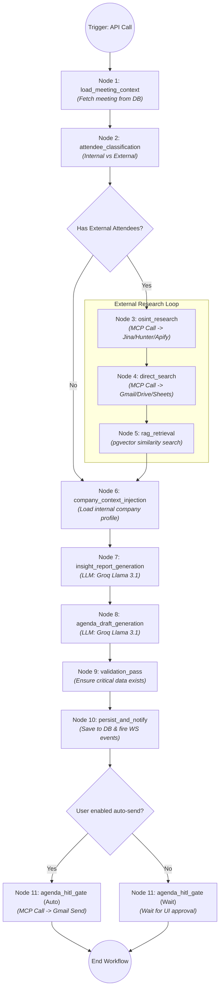

<div align="center">
  <h1>MeetingPilot ✈️</h1>
  <p><strong>Agentic Meeting Intelligence & OSINT Orchestration Platform</strong></p>
  <p>Automate your meeting prep. Connect Google Workspace, run multi-source OSINT, and generate highly contextual agendas and intelligence briefs automatically via AI workflows.</p>
</div>

---

## 📌 What is MeetingPilot?

MeetingPilot is a full-stack, AI-driven productivity platform designed to eliminate the friction of meeting preparation. 

It acts as an autonomous AI agent that intercepts your upcoming meetings, researches external attendees using Open Source Intelligence (OSINT), scans your internal company data (Gmail, Drive, Sheets) for past context, and uses Large Language Models (LLMs) to automatically generate comprehensive meeting briefs and draft agendas. 

### What Problem It Solves
Professionals spend hours researching attendees, hunting through Google Drive for past context, and manually drafting agendas before important calls. MeetingPilot completely automates this workflow, acting as an AI Chief of Staff that prepares everything you need before the meeting begins.

---

## 🛠️ Technologies Used

The project is structured as a scalable, containerized microservices architecture.

### **Backend & AI Architecture**
- **Python / FastAPI**: High-performance asynchronous API layer.
- **NeonDB (PostgreSQL) & pgvector**: Relational storage and vector embeddings for semantic search.
- **Redis & asyncio**: FIFO queueing and background worker processes for non-blocking workflows.
- **State-Graph**: 11-node agentic workflow orchestrator.
- **Groq API (Llama 3.1 8B)**: Lightning-fast LLM inference.
- **sentence-transformers**: Semantic chunking and vector embeddings.
- **Model Context Protocol (MCP) & FastMCP**: Running external data tools (OSINT, Google Workspace) in secure, isolated `stdio` subprocesses.

### **Frontend & Client**
- **React.js & TypeScript**: Modern, responsive UI built with Tailwind CSS.
- **Vite**: Ultra-fast frontend build tooling.
- **Chrome Extension APIs**: Seamless browser integration for "1-click meeting context."
- **WebSockets**: Real-time progress updates and status synchronization.

### **Integrations**
- **Google Workspace (OAuth 2.0)**: Deep, secure integration with Gmail, Calendar, Google Drive, and Google Sheets.
- **OSINT Tools**: Jina AI, Hunter, Apify, LinkdAPI for deep external attendee research.

### **Infrastructure**
- **Docker & Docker Compose**: 1-click full-stack containerized deployment.

---

## 🏗️ Architecture & Data Flow

MeetingPilot leverages an event-driven agent architecture, interacting with isolated **MCP Subprocesses** for secure data fetching.

### How It Works (The Flow)
1. **OAuth SSO**: User logs in securely via Google SSO, granting scopes for Calendar, Drive, and Gmail.
2. **Knowledge Base (KB) Ingestion**: A background RAG pipeline downloads recent emails and docs, semantically chunks them, and stores them in `pgvector`.
3. **Trigger**: When a meeting is detected, the 11-node workflow starts in a background Redis worker.
4. **Classification**: Attendees are classified as internal (same domain) or external.
5. **Data Federation (MCP)**:
   - *OSINT MCP Server* dynamically fetches LinkedIn and web data for external attendees.
   - *Google Workspace MCP Server* searches past emails and docs mentioning the attendees.
6. **LLM Generation**: The aggregated context is sent to Llama 3.1 to generate an Insight Brief and an Agenda.
7. **Human-in-the-Loop (HITL)**: The system halts for human review on the frontend, or auto-sends the agenda via Gmail if configured.

### Workflow Diagram



---

## 🔒 Security & Privacy

Handling user emails and Google Workspace data requires strict security principles:
- **Stateless MCP Servers**: The servers that interact with Google APIs or OSINT tools are stateless. OAuth tokens are *never* stored in environment variables. They are securely injected per-request by the MCP Client.
- **Single SSO Architecture**: Users are never asked to provide raw API keys. All integrations operate off a single, secure Google OAuth 2.0 consent flow.
- **Data Isolation**: Each user's RAG data and meeting reports are hard-partitioned in PostgreSQL via `user_id` foreign keys.
- **Admin Failsafes**: Dangerous operations (like viewing analytics or system quotas) are hardcoded to a master admin email verification step on the server side.

---

## 🚀 How to Run

MeetingPilot is fully containerized. A single Docker command brings up the database, Redis queue, FastAPI backend, background workers, and the React frontend.

### Prerequisites
- Docker & Docker Compose
- API Keys (Google OAuth Client, Groq, OSINT APIs)

### Steps
1. **Clone the repository**:
   ```bash
   git clone https://github.com/your-username/MeetingPilot.git
   cd MeetingPilot
   ```

2. **Configure Environment Variables**:
   Copy the example environment file and fill in your keys.
   ```bash
   cp apps/backend/.env.example apps/backend/.env
   ```
   *Note: Ensure your `DATABASE_URL` (NeonDB) and `GROQ_API_KEY` are populated.*

3. **Start the Application**:
   Bring up the entire stack (Backend, Redis, Worker, Frontend).
   ```bash
   docker-compose up --build
   ```

4. **Access the App**:
   - Frontend UI: `http://localhost:3000`
   - Backend API Docs: `http://localhost:8000/docs`

---
*Built as a cutting-edge demonstration of Agentic orchestration, RAG, and multi-protocol data federation.*
